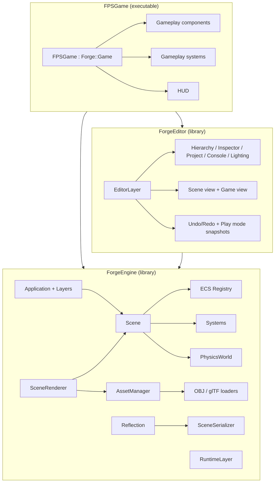

# Forge Engine — Complete Documentation

Forge is a C++17 / OpenGL 3.3 game engine packaged as a reusable static library, with a Unity-style
editor library on top of it, and **Arena FPS**, a complete first-person shooter built with both.

| | |
|---|---|
| Language / standard | C++17 (MSVC 2022 tested; any C++17 compiler + CMake 3.20 should work) |
| Graphics API | OpenGL 3.3 core profile |
| Architecture | Entity Component System (sparse sets) + reflection |
| Libraries produced | `ForgeEngine` (runtime), `ForgeEditor` (editor) |
| Executables | `FPSGame` (editor + game), `ForgeTests` (test suite) |
| Third-party code | GLFW 3.4, glad 2 (GL 3.3 loader), GLM 1.0.1, Dear ImGui 1.91.5 (docking), ImGuizmo, stb_image / stb_image_write |

---

## Table of contents

1. [Quick start](#1-quick-start)
2. [Repository layout](#2-repository-layout)
3. [Architecture overview](#3-architecture-overview)
4. [Core module](#4-core-module)
5. [Entity Component System](#5-entity-component-system)
6. [Built-in components](#6-built-in-components)
7. [Reflection](#7-reflection)
8. [Scenes and serialization](#8-scenes-and-serialization)
9. [Rendering pipeline](#9-rendering-pipeline)
10. [Shaders](#10-shaders)
11. [Materials](#11-materials)
12. [Assets and model loaders](#12-assets-and-model-loaders)
13. [Physics](#13-physics)
14. [Particles, lifetimes and debug drawing](#14-particles-lifetimes-and-debug-drawing)
15. [The editor](#15-the-editor)
16. [Arena FPS (the game)](#16-arena-fps-the-game)
17. [Building your own game on Forge](#17-building-your-own-game-on-forge)
18. [Tests](#18-tests)
19. [Command-line reference](#19-command-line-reference)
20. [Conventions, limitations and future work](#20-conventions-limitations-and-future-work)

---

## 1. Quick start

### Requirements

- Windows 10/11 with **Visual Studio 2019 or 2022** and the *Desktop development with C++* workload
  (it ships the MSVC compiler, CMake and Ninja that `build.bat` uses).
- A GPU/driver with OpenGL 3.3 support.
- Python 3 is only needed if you want to regenerate the procedural assets (they are already in `assets/`).

All third-party dependencies are vendored in `external/`, so the build is fully offline.

### Build

```bat
build.bat                 :: Release build (default)
build.bat Debug           :: Debug build
build.bat RelWithDebInfo
```

The script locates Visual Studio with `vswhere`, loads the x64 developer environment, then runs
`cmake -G Ninja` into `build\<Config>\` and builds everything. Output:

```
build\Release\bin\FPSGame.exe      editor + game
build\Release\bin\ForgeTests.exe   test suite
build\Release\bin\assets\          copy of the asset folder (post-build step)
build\Release\lib\                 ForgeEngine.lib, ForgeEditor.lib, third-party libs
```

You can also open the folder in Visual Studio ("Open Folder") or use CMake directly:

```bat
cmake -S . -B build/vs -G "Visual Studio 17 2022"
cmake --build build/vs --config Release
```

### Run

| Command | What it does |
|---|---|
| `FPSGame.exe` | Opens the **Forge Editor** with `scenes/Arena.scene` (generated on first run). Press **Play** or **Ctrl+P**. |
| `FPSGame.exe --game` | Runs the **standalone game** fullscreen in the window (no editor). |
| `FPSGame.exe --play` | Opens the editor and immediately enters play mode. |
| `ForgeTests.exe` | Runs the automated test suite. |

Inside the editor's Game view, **click to capture the mouse**, **Esc** to release it.

---

## 2. Repository layout

```
FPS-Game-Engine/
├── CMakeLists.txt              root build (external, engine, editor, game, tests)
├── build.bat                   one-click MSVC/Ninja build
├── DOCUMENTATION.md            this file
├── README.md
├── assets/                     everything loaded at runtime
│   ├── shaders/                GLSL programs (*.glsl, hot reloaded)
│   ├── models/                 crate/barrel/pillar/muzzleflash .obj+.mtl, rifle.gltf+.bin, drone.glb
│   ├── textures/               procedural PNGs
│   ├── materials/              *.mat (JSON)
│   └── scenes/                 *.scene (JSON) — Arena.scene is generated on first run
├── engine/                     ForgeEngine static library (runtime)
│   ├── include/Forge/          public headers (Forge/Forge.h is the umbrella header)
│   │   ├── Core/               Application, Layer, Game, Input, Time, Log, FileSystem, Json
│   │   ├── Math/               AABB, Ray, Frustum, euler/matrix helpers, Random
│   │   ├── ECS/                Registry (sparse sets), System, Reflection
│   │   ├── Scene/              Scene, built-in Components, CoreSystems, SceneSerializer
│   │   ├── Physics/            PhysicsWorld (raycasts, box movement)
│   │   ├── Renderer/           Shader, Texture2D, Framebuffer, Mesh, Material/Model,
│   │   │                       Primitives, DebugDraw, SceneRenderer
│   │   ├── Assets/             AssetManager, ModelLoaders (OBJ, glTF)
│   │   └── Runtime/            RuntimeLayer (standalone player)
│   └── src/                    implementation (.cpp) mirroring the include tree
├── editor/                     ForgeEditor static library (Unity-style editor)
│   ├── include/Forge/Editor/   EditorLayer, EditorCamera, PropertyDrawer, Icons, EditorTheme
│   └── src/                    EditorLayer.cpp (menus, play mode, undo), EditorPanels.cpp,
│                               EditorViewports.cpp, PropertyDrawer.cpp, Icons.cpp, ...
├── game/src/                   Arena FPS (components, systems, prefabs, level builder, HUD, main)
├── tests/                      ForgeTests executable
├── tools/generate_assets.py    procedural asset generator (textures, OBJ, glTF, GLB, materials)
└── external/                   GLFW, glad, GLM, Dear ImGui (docking), ImGuizmo, stb
```

CMake targets: `ForgeEngine` (alias `Forge::Engine`), `ForgeEditor` (alias `Forge::Editor`),
`FPSGame`, `ForgeTests`, plus the third-party `glfw`, `glad`, `glm`, `imgui`, `stb`.

---

## 3. Architecture overview



**Frame loop** (`Application::run`):

1. `glfwPollEvents`, `Time::tick`, `Input::update`
2. Shader hot reload check (once per second)
3. ImGui new frame
4. `Layer::onUpdate(dt)` for every layer — simulation (`Scene::update`)
5. `Layer::onImGui()` — UI; the editor renders its Scene/Game views here into off-screen targets
6. ImGui render to the window, `DebugDraw::endFrame`, optional screenshot, swap buffers

The editor (`Forge::Editor::EditorLayer`) and the standalone player (`Forge::RuntimeLayer`) are both
*layers*; the game picks one in `main()`.

---

## 4. Core module

Header: `Forge/Core/*.h`.

### Application & layers

```cpp
Forge::AppConfig cfg = Forge::AppConfig::fromArgs(argc, argv);   // parses command line
Forge::Application app(cfg);        // window, GL 3.3 core context, glad, ImGui (docking), fonts
app.pushLayer(Forge::MakeScope<MyLayer>());
return app.run();
```

`Layer` callbacks: `onAttach`, `onDetach`, `onUpdate(float dt)`, `onImGui()`.
`Application::get()` gives access to the window, fonts (`fonts().regular/bold/medium/large`),
`framebufferSize()`, `setTitle`, `setVSync`, `requestScreenshot(path)` and `close()`.

### Game interface

`Forge::Game` (`Forge/Core/Game.h`) is what a game implements:

| Method | Called |
|---|---|
| `name()` | window title / editor title |
| `registerComponents()` | once at startup — register gameplay components with reflection |
| `setupScene(Scene&)` | for every scene created or loaded — add gameplay systems |
| `createDefaultScene(Scene&)` | when the startup scene file does not exist (or `--rebuild-scene`) |
| `startupScene()` | asset path of the scene to open (e.g. `scenes/Arena.scene`) |
| `onGUI(Scene&, const Viewport&)` | every frame while playing — draw the HUD into `viewport.drawList` |
| `onEditorMenu(Scene&)` | adds custom menus to the editor's main menu bar |

### Time

`Time::deltaTime()` (scaled), `unscaledDeltaTime()`, `time()`, `frameCount()`, `fps()`,
`setTimeScale(float)`. Frame deltas are clamped to 0.1 s to keep simulation stable after hitches.

### Input

Unity-like static API with GLFW-compatible key codes (`Forge::Key::W`, `Forge::Mouse::Left`, ...):

```cpp
Input::getKey(Key::W);  Input::getKeyDown(Key::Space);  Input::getKeyUp(Key::R);
Input::getMouseButton(Mouse::Left);  Input::mouseDelta();  Input::scrollDelta();
Input::setCursorLocked(true);       // hides + captures the cursor (raw mouse motion when available)
Input::setEnabled(false);           // all gameplay queries return "not pressed"
```

The editor enables gameplay input only while the Game view has captured the mouse, so editor
clicks and shortcuts never leak into the game. `Input::rawMouseDelta()` ignores that gate and is used
by editor tools (scene camera).

### Log

`LOG_TRACE / LOG_INFO / LOG_WARN / LOG_ERROR` (printf-style). Messages go to stdout/stderr and into a
thread-safe ring buffer (4000 entries) displayed by the editor Console.

### FileSystem

Asset paths are relative to the **asset root** (`"models/crate.obj"`). `FileSystem::initAssetRoot(argv[0])`
prefers the source folder baked in at compile time (`FORGE_ASSET_DIR`, so editor saves go into the
project), then `<exe>/assets`, `<exe>/../assets`, `<cwd>/assets`. Helpers: `resolve`, `toAssetPath`,
`readText/readBinary/writeText`, `listAssets(dir)`, `findAssets({".obj", ...})`, `extension`, `stem`...

### Json

`Forge::Json` is a small DOM (null/bool/number/string/array/object, insertion-ordered objects) with a
parser (UTF-8, `\u` escapes and surrogate pairs, `//` comments tolerated) and a pretty printer
(numeric arrays stay on one line). It is used for scenes, materials and glTF.

---

## 5. Entity Component System

Headers: `Forge/ECS/Registry.h`, `Forge/ECS/System.h`.

### Entities

An `Entity` is a 32-bit handle: **20 bits slot index + 12 bits version**. Destroying an entity bumps its
slot's version, so stale handles are rejected by `registry.valid(e)` even after the slot is reused.
`NullEntity` (`0xFFFFFFFF`) means "no entity".

### Component storage (sparse sets)

Each component type `T` gets a `ComponentPool<T>`:

- **sparse** array: entity index → dense slot (`npos` when absent)
- **dense** entity array + component array (`std::deque<T>`)

Lookups, insertion and removal are O(1). Removal swaps the last element into the hole.
Storing components in a `std::deque` means **references stay valid when other components of the same
type are added** — systems can spawn entities while iterating without dangling references.

### Registry API

```cpp
Registry reg;
Entity e = reg.create();
auto& t = reg.emplace<Transform>(e);           // aggregates are brace-initialised
reg.get<Transform>(e);  reg.tryGet<Light>(e);  reg.has<Camera>(e);  reg.remove<Light>(e);
reg.each<Transform, MeshRenderer>([](Entity e, Transform& t, MeshRenderer& mr) { ... });
std::vector<Entity> list = reg.view<Enemy, Health>();
reg.count<Enemy>();  reg.destroy(e);  reg.valid(e);
```

`each<Ts...>` iterates a *snapshot* of the smallest pool among `Ts`, skipping entities that were
destroyed or lost a component during the loop. Creating/destroying entities inside the callback is safe.

### Systems

```cpp
class SpinSystem : public Forge::System {
public:
    const char* name() const override { return "SpinSystem"; }
    void onStart(Scene& scene) override { /* play mode entered */ }
    void onUpdate(Scene& scene, float dt) override {
        scene.each<Spinner, Transform>([&](Entity, Spinner& s, Transform& t) { t.rotation += s.speed * dt; });
    }
    void onStop(Scene& scene) override { /* play mode exited */ }
};
scene.addSystem<SpinSystem>();
```

- Systems run in ascending `priority` order (`SystemPriority::Gameplay = 0`, `Physics = 100`,
  `Particles = 200`, `Lifetime = 300`).
- By default they run only while the scene is **playing**; set `runInEditMode = true` to also tick in
  the editor. `enabled = false` skips a system.
- Every scene automatically owns three engine systems: `RigidBodySystem`, `ParticleSystem`,
  `LifetimeSystem`.

`Scene::update(dt)` does: update transforms → rebuild physics colliders → run systems → update
transforms again → flush deferred destruction.

---

## 6. Built-in components

Header: `Forge/Scene/Components.h`. Every entity always has `EntityInfo` and `Transform`.

| Component | Fields | Notes |
|---|---|---|
| `EntityInfo` | `name`, `tag`, `active`, `uuid` | `activeInHierarchy` is computed (active && parent active). |
| `Transform` | `position`, `rotation` (Euler degrees), `scale` | Rotation order Y·X·Z (yaw, pitch, roll) like Unity. `parent`/`children` are managed by `Scene::setParent`; `world` matrix computed each frame. Helpers `forward()` (−Z), `right()`, `up()`, `worldPosition()`. |
| `Camera` | `fieldOfView`, `nearClip`, `farClip`, `primary`, `clear` (Skybox/Solid Color), `background` | The Game view renders the first active *primary* camera. |
| `MeshRenderer` | `mesh` (asset path or `builtin:Cube|Sphere|Plane|Quad|Cylinder|Capsule`), `material` (optional `.mat` override), `tint`, `castShadows`, `visible`, `layer` (World/Viewmodel) | Model/material are resolved lazily and cached. |
| `Light` | `type` (Directional/Point/Spot), `color`, `intensity`, `range`, `spotAngle`, `castShadows` | First directional light is the sun (shadows). Up to 16 point/spot lights per view (closest to the camera). |
| `BoxCollider` | `center`, `size`, `isTrigger` | Local-space box, transformed by the entity's world matrix. |
| `RigidBody` | `mass`, `drag`, `bounciness`, `useGravity`, `isKinematic` (+ runtime `velocity`) | Simulated by `RigidBodySystem` against colliders. |
| `CharacterController` | `height`, `radius` (+ runtime `velocity`, `grounded`) | Moved by gameplay code via `PhysicsWorld::moveBox`. |
| `ParticleEmitter` | `emitting`, `loop`, `rate`, `burst`, `maxParticles`, `lifetime`, `startSpeed`, `spread`, `direction`, `gravity`, `drag`, `startSize/endSize`, `startColor/endColor` (HDR) | CPU particles, additive camera-facing quads. |
| `Lifetime` | `seconds` | Entity is destroyed when it reaches 0 (play mode). |

---

## 7. Reflection

Header: `Forge/ECS/Reflection.h`. Components describe their fields once; that single description
drives the **Inspector**, the **scene serializer**, the **Add Component** menu and copy/paste/undo.

```cpp
ComponentRegistry::instance().add<Weapon>("Weapon", "Gameplay")
    .field("Damage", &Weapon::damage, 0.5f, 0.0f, 500.0f)        // float: drag speed, slider min/max
    .field("Magazine Size", &Weapon::magazineSize, 1.0f, 1, 200) // int
    .field("Rest Position", &Weapon::restPosition, 0.005f)       // vec3 -> Unity-style X/Y/Z fields
    .color("Tint", &Weapon::tint, /*hdr*/ false)                  // vec3/vec4 color picker
    .enumeration("Mode", &Weapon::mode, {"Semi", "Auto"})         // int-sized enum -> combo box
    .asset("Mesh", &Weapon::mesh, AssetKind::Model)               // string path, drag & drop target
    .entity("Muzzle Flash", &Weapon::muzzleFlash)                 // entity reference (saved by UUID)
    .tooltip("Shown when hovering the label")
    .removable(true).hidden(false);
```

Field types: `Bool, Int, Float, Vec2, Vec3, Vec4, Color3, Color4, String, Enum, Asset, Entity`.
Only reflected fields are serialized; everything else in a component is runtime state that is reset
when a scene loads (perfect for timers, caches, velocities...).

Plain structs can be described too with `describe<T>(meta, "Name")` — the scene `Environment`
(Lighting window) and `Material` (material inspector) use this.

`Reflection::toJson / fromJson` convert any described object to and from JSON.

---

## 8. Scenes and serialization

### Scene API (`Forge/Scene/Scene.h`)

```cpp
Scene scene("Level");
Entity e = scene.createEntity("Crate", /*parent*/ NullEntity);
scene.add<MeshRenderer>(e).mesh = "models/crate.obj";
scene.setParent(child, parent, /*keepWorldTransform*/ true);
scene.destroyEntity(e);            // recursive; deferred while systems are running
Entity copy = scene.duplicate(e);  // deep copy with fresh UUIDs, internal references remapped
scene.findByName("Player");  scene.findByUUID(id);  scene.findChild(parent, "Muzzle");
scene.findWithTag("Enemy");  scene.primaryCamera();  scene.isActive(e);
scene.setWorldPosition(e, p);  scene.setWorldMatrix(e, m);  scene.parentWorld(e);
scene.beginPlay(); scene.update(dt); scene.endPlay();
scene.environment.fogDensity = 0.02f;   // per-scene render settings
```

### File format (`*.scene`)

```json
{
  "name": "Arena",
  "environment": { "Sky Color": [0.34, 0.52, 0.82], "SSAO": true, "SSAO Radius": 0.6, ... },
  "entities": [
    {
      "uuid": "3f6c0a12b9e4d771", "name": "Player", "tag": "Player", "active": true,
      "parent": "0000000000000000",
      "components": {
        "Transform": { "Position": [0, 0.95, 22], "Rotation": [0, 0, 0], "Scale": [1, 1, 1] },
        "Character Controller": { "Height": 1.8, "Radius": 0.35 },
        "Player": { "Move Speed": 6, "Camera": "a1b2c3d4e5f60718", "Weapon": "0f1e2d3c4b5a6978", ... }
      }
    }
  ]
}
```

- Entities are written parents-first; UUIDs (64-bit hex) identify entities across saves.
- Entity references (`.entity(...)` fields) are stored as UUIDs and resolved on load.
- Unknown components are skipped with a warning, missing fields keep their defaults, so scenes
  survive component changes.
- `SceneSerializer::serializeEntities` / `instantiate` copy sub-trees with fresh UUIDs (used by
  duplicate, copy/paste and as a lightweight prefab mechanism).

---

## 9. Rendering pipeline

`Forge::SceneRenderer` renders a `Scene` from a `CameraData` into its own set of render targets.
Create one per view (the editor has two: Scene view and Game view; the player has one).

```cpp
SceneRenderer renderer;
CameraData cam = CameraData::fromEntity(scene, scene.primaryCamera(), aspect);
RenderOptions opt;                 // debugView, editor, grid, gizmos, outline, debugLines
renderer.render(scene, cam, width, height, opt);
ImGui::Image((ImTextureID)(uintptr_t)renderer.outputTexture(), size, {0, 1}, {1, 0});
```

### Frame graph


| Pass | Target | Details |
|---|---|---|
| Collect | — | `MeshRenderer`s resolve model/material through the `AssetManager`; one draw item per sub-mesh; lights sorted by distance (max 16 + sun). |
| Shadow map | `Depth24` 2048×2048 | Orthographic box (size = *Shadow Distance*) in front of the camera, **snapped to texels** to prevent shimmering, polygon offset, light-frustum culling. Only `World` layer casters. |
| Prepass | `RGB16F` normals + `Depth24` | View-space normals for SSAO. |
| **SSAO** | `R16F` (½ res) | Normal-oriented hemisphere kernel (up to 64 samples, scaled towards the center), 4×4 rotation-noise texture, view-space positions reconstructed from depth via the inverse projection, range check to avoid halos, `pow(ao, power)`. Then a 4×4 box blur matching the noise tile. |
| Forward (HDR) | `RGBA16F` + depth | Lit / Unlit materials, procedural sky (at far plane), editor grid, additive particles, debug/gizmo lines. Then the depth buffer is cleared and the **Viewmodel** layer is drawn (first-person weapons never clip into walls and do not receive screen-space AO from the world behind them). |
| Bloom | `RGBA16F` (½ res) ×2 | Soft-knee threshold, 3 iterations of 9-tap separable gaussian with growing radius. |
| Composite | `RGBA8` | Bloom add, exposure, **ACES filmic** tone mapping, gamma 2.2, vignette; luma in alpha. |
| FXAA | `RGBA8` (output) | FXAA 3.11-style edge anti-aliasing. |
| Outline | output | Selected entities (and children) rendered to an `R8` mask; edge detection draws Unity's orange outline. |

### Lighting model (`Lit.glsl`)

- **Cook-Torrance PBR**: GGX distribution, Smith-Schlick geometry, Schlick Fresnel, metallic/roughness.
  Light intensities follow Unity's convention (intensity 1 = fully lit white diffuse).
- **Sun**: first directional light, 5×5 PCF shadows with slope-scaled bias + normal offset, fading out
  at the edge of the shadow distance.
- **Point/Spot lights**: Unity-style falloff `1/(1+25·(d/r)²)` with a smooth fade to zero at the range;
  spot cones with a soft inner edge.
- **Ambient**: hemispheric (sky / horizon / ground colors) diffuse + rough specular approximation,
  multiplied by **SSAO**; 25% of the AO is also applied to direct light so contact areas stay grounded.
- **Fog**: exponential-squared distance fog.
- Colors are authored in sRGB and converted to linear on the CPU; HDR colors keep their intensity.

### Debug views

`RenderOptions::debugView` (Scene view *Shaded* dropdown / Lighting window):
**Shaded**, **Ambient Occlusion** (raw SSAO buffer), **Normals**, **Albedo**, **Lighting Only**.

### Render settings (per scene: `Environment`, edited in the *Lighting* window)

Sky/horizon/ground colors, ambient & sky intensity, fog (color, density), SSAO (on/off, radius, bias,
power, samples), shadows (on/off, distance, bias, softness), exposure, bloom (on/off, threshold,
intensity), FXAA, vignette.

### Statistics

`renderer.stats()` → draw calls, triangles, lights, shadow casters, particles (Game view *Stats*
button, Scene view overlay, `F3` in the standalone player).

---

## 10. Shaders

Shaders live in `assets/shaders/` as **single files containing all stages**:

```glsl
#version 330 core          // shared prefix: copied into every stage
// comments...

#type vertex
layout(location = 0) in vec3 a_Position;   // 0 position, 1 normal, 2 uv
...
#type fragment
#include "Common.glsl"     // resolved relative to this file (nested includes allowed)
...
```

**Hot reload**: the application checks shader file timestamps every second and recompiles changed
programs; on a compile error the previous program is kept and the error is printed to the Console.
*Assets → Reload Shaders* forces a recompile.

| Shader | Purpose |
|---|---|
| `Lit.glsl` | Standard PBR surface (sun + shadows, 16 lights, SSAO ambient, fog, debug views) |
| `Unlit.glsl` | Flat color × texture + emission (projectiles, muzzle flashes, UI-like surfaces) |
| `Depth.glsl` | Shadow map depth pass |
| `Prepass.glsl` | Depth + view-space normals |
| `SSAO.glsl`, `SSAOBlur.glsl` | Screen-space ambient occlusion + blur |
| `Skybox.glsl` | Procedural gradient sky with sun disc |
| `Grid.glsl` | Infinite editor grid (1 m / 10 m lines, red X and blue Z axes) |
| `Lines.glsl` | Debug / gizmo lines |
| `Particles.glsl` | Soft additive particles |
| `BloomPrefilter.glsl`, `Blur.glsl` | Bloom |
| `Composite.glsl` | Tone mapping, gamma, vignette |
| `FXAA.glsl` | Anti-aliasing |
| `Mask.glsl`, `Outline.glsl` | Selection outline |
| `Common.glsl`, `FullscreenVS.glsl` | Includes: fog + triplanar sampling, fullscreen triangle |

### Uniforms set by the renderer for surface shaders

| Uniform | Meaning |
|---|---|
| `u_ViewProj`, `u_Model`, `u_NormalMatrix` | transforms |
| `u_CameraPos`, `u_DebugView` | camera position, debug view index |
| `u_Albedo`, `u_AlbedoMap` (unit 0), `u_Tiling`, `u_WorldSpaceUV`, `u_Metallic`, `u_Roughness`, `u_Emission` | material |
| `u_SkyColor`, `u_HorizonColor`, `u_GroundColor`, `u_AmbientIntensity` | ambient |
| `u_HasSun`, `u_SunDirection`, `u_SunColor` | sun |
| `u_LightCount`, `u_LightPosRange[16]`, `u_LightColorType[16]`, `u_LightDirCone[16]` | point/spot lights |
| `u_ShadowsEnabled`, `u_ShadowMap` (unit 1), `u_LightSpace`, `u_ShadowBias`, `u_ShadowSoftness`, `u_ShadowTexel` | shadows |
| `u_UseSSAO`, `u_SSAO` (unit 2), `u_ScreenSize` | ambient occlusion |
| `u_FogEnabled`, `u_FogColor`, `u_FogDensity` | fog |

The `Shader` class (`Forge/Renderer/Shader.h`) caches uniform locations and offers
`setInt/Float/Vec2/Vec3/Vec4/Mat3/Mat4/Vec3Array/Vec4Array`. You can load extra shaders with
`AssetManager::getShader("MyShader")` (→ `assets/shaders/MyShader.glsl`).

---

## 11. Materials

A material is either embedded in a model (OBJ `.mtl`, glTF material) or a `.mat` JSON asset:

```json
{
  "Shader": "Lit",
  "Albedo": [0.85, 0.85, 0.85, 1],
  "Albedo Map": "textures/grid.png",
  "Metallic": 0.0,
  "Roughness": 0.75,
  "Emission": [0, 0, 0],
  "Tiling": [0.25, 0.25],
  "World Space UV": true,
  "Name": "Floor"
}
```

| Field | Meaning |
|---|---|
| Shader | `Lit` or `Unlit` |
| Albedo / Albedo Map | base color × texture (sRGB) |
| Metallic / Roughness | PBR parameters |
| Emission | HDR emissive color — values above 1 bloom |
| Tiling | UV scale (or repeats per meter in world-space mode) |
| World Space UV | triplanar projection in world units — scaled cubes get correctly tiled textures, ideal for level blockouts (like Unity's ProBuilder prototype materials) |

Assign a material by setting `MeshRenderer.material`, dragging a `.mat` from the Project window onto
an object in the Scene view / Hierarchy, or onto the Material field in the Inspector.
Selecting a `.mat` in the Project window shows a material inspector; edits are saved automatically.
*Assets → Create Material* creates a new `.mat` in the current Project folder.

---

## 12. Assets and model loaders

### AssetManager (`Forge/Assets/AssetManager.h`)

```cpp
Ref<Model>     m = AssetManager::getModel("models/drone.glb");      // or "builtin:Sphere"
Ref<Material>  mat = AssetManager::getMaterial("materials/Wall.mat");
Ref<Texture2D> t = AssetManager::getTexture("textures/crate.png", /*srgb*/ true);
Ref<Shader>    s = AssetManager::getShader("Lit");
AssetManager::reloadShaders(); AssetManager::reloadAssets();
```

Everything is cached by path; failures are cached too (no log spam). A `Model` is a list of
`SubMesh { Ref<Mesh>, materialIndex }` + materials + bounds. `Mesh` keeps a CPU copy of its triangles
for editor picking (`Model::raycast`).

### OBJ loader (`loadOBJ`)

- `v`, `vt`, `vn`; faces with `v`, `v/vt`, `v//vn`, `v/vt/vn`; **negative (relative) indices**
- polygons of any size (fan triangulation)
- `usemtl` groups faces into **one sub-mesh per material**; vertices are de-duplicated per sub-mesh
- `mtllib` / MTL: `Kd`, `Ke`, `Ns` (→ roughness), `Pr`/`Pm` (PBR extension), `d`/`Tr`, `map_Kd`
  (texture options before the file name are skipped)
- smooth normals are generated (area weighted) when the file has none

### glTF 2.0 loader (`loadGLTF`)

- `.gltf` with external `.bin` or base64 `data:` URIs, and binary `.glb` (JSON + BIN chunks)
- accessors of every component type (byte/short/int/float, `normalized`), interleaved `byteStride`
- walks the **default scene's node hierarchy** and bakes node transforms (TRS or matrix) into the
  vertices; mirrored transforms flip the winding
- `POSITION`, `NORMAL` (generated if missing), `TEXCOORD_0` (V flipped to OpenGL convention), indices
  (u8/u16/u32) or non-indexed
- materials: `pbrMetallicRoughness` base color factor + texture, metallic/roughness factors,
  `emissiveFactor`, `KHR_materials_emissive_strength`, `KHR_materials_unlit`
- images from files, data URIs or **GLB buffer views** (PNG/JPG via stb_image)
- primitives sharing a material are merged into one sub-mesh to save draw calls

### Built-in primitives

`builtin:Cube` (1 m), `Sphere` (Ø1), `Plane` (10×10), `Quad` (1×1), `Cylinder` (h2 Ø1), `Capsule`
(h2 Ø1) — same dimensions as Unity's.

### Procedural asset generator

`python tools/generate_assets.py` (standard library only) regenerates everything in `assets/textures`,
`assets/models` and `assets/materials`: a PNG encoder, tileable fBm noise textures (prototype grid,
concrete, crate, brushed metal, hazard stripes), OBJ/MTL writers (crate, barrel, pillar, muzzle
flash), a glTF writer (rifle with a node hierarchy and quaternion-rotated parts, external `.bin`) and a
GLB writer (drone with an **embedded PNG** and emissive-strength materials).

---

## 13. Physics

`Forge::PhysicsWorld` (owned by each `Scene`, `scene.physics()`) is a lightweight game-physics layer:

- Colliders are gathered from `BoxCollider` components every frame (`rebuild`) — oriented boxes for
  raycasts, axis-aligned world bounds for movement. `refresh(scene, e)` updates one collider mid-frame.
- `raycast(ray, maxDistance, hit, ignore, hitTriggers)` → closest `RaycastHit { entity, point, normal, distance }`
  (broad phase on world AABBs, exact ray-vs-OBB test).
- `overlapBox(aabb, ignore)` → overlapping entities.
- `moveBox(center, halfExtents, delta, ignore)` → `MoveResult { position, grounded, hitCeiling, blocked }`:
  collide-and-slide resolved per axis (Y first, then X and Z), sub-stepped to avoid tunnelling.
  Used for the player's `CharacterController`, enemies and rigid bodies.
- `RigidBodySystem` integrates gravity (`physics.gravity`, default −20 m/s² for snappy FPS feel) and
  drag, resolves collisions with bounciness and ground friction.

Limitations: no rotational dynamics, boxes only (sufficient for blockout-style levels and props).

---

## 14. Particles, lifetimes and debug drawing

- **ParticleEmitter** + `ParticleSystem`: CPU simulation (gravity, drag, size/color over lifetime),
  bursts for one-shot effects (`loop = false`, `burst = N`), continuous emission (`rate`). Rendered as
  soft additive billboards in the HDR pass, so HDR colors bloom.
- **Lifetime**: auto-destroys an entity after N seconds (impacts, explosions, projectiles).
- **DebugDraw**: `DebugDraw::line/box/sphere(..., color, duration)` from anywhere; lines with a duration
  persist (the rifle's bullet tracers use this). `LineBatch` offers lines, boxes, circles, spheres,
  arrows, cones and frustums (the editor's gizmos are built with it).

---

## 15. The editor

`FPSGame.exe` starts the editor (`Forge::Editor::EditorLayer`). The look and layout follow Unity's
dark editor skin: menu bar, tool bar with transform tools and centered Play/Pause/Step, and dockable
panels (drag tabs to rearrange; *Window → Reset Layout* restores the default; the layout is stored in
`ForgeEditor.ini` next to the asset folder).

### Panels

| Panel | Features |
|---|---|
| **Hierarchy** | Scene tree with type icons, search filter, drag & drop to re-parent (keeps world transform) or drop on empty space to un-parent, drop models to instantiate, drop materials onto objects, context menu (create child, duplicate, copy, delete, activate/deactivate, create submenu), inactive entities greyed out, double-click to frame. |
| **Scene** | Free editor camera, infinite grid, light & camera icons (click to select), click-to-select picking (ray vs triangles), orange selection outline, ImGuizmo move/rotate/scale gizmos (global/local, snapping), collider/light/camera/emitter gizmos, orientation gizmo, shading dropdown (Shaded / AO / Normals / Albedo / Lighting), drop models (placed on the surface under the cursor), scenes and materials. |
| **Game** | Renders the primary camera exactly as the player sees it, with the HUD. Click to capture the mouse, Esc to release. *Stats* overlay. "No cameras rendering" when the scene has none. |
| **Inspector** | Active toggle, name, tag, UUID; one collapsible section per component generated from reflection (Unity-style X/Y/Z vector fields, sliders, color pickers, enum combos, asset fields with picker and drag & drop, entity reference fields); component menu (Reset / Remove); *Add Component* searchable menu; helpers such as *Fit To Mesh* for box colliders and mesh statistics. Selecting an asset shows an asset inspector (material editor, model statistics, texture preview, scene open button). |
| **Project** | Folder tree + icon grid of the asset folder with thumbnails for textures and color swatches for materials, breadcrumbs, search across the project, icon size slider, drag assets into the Scene/Hierarchy/Inspector, double-click to open scenes / instantiate models / enter folders, context menu to create materials and folders. |
| **Console** | Log with info/warning/error toggles and counts, text filter, auto-scroll, details pane, clear. |
| **Lighting** | Scene environment & render settings (sky, ambient, fog, SSAO, shadows, bloom, exposure, FXAA, vignette) and the scene view debug mode. |

### Scene view controls

| Input | Action |
|---|---|
| Right mouse + move | look around |
| Right mouse + W/A/S/D, Q/E | fly (Shift = 3× speed), mouse wheel changes fly speed |
| Middle mouse drag | pan |
| Alt + left mouse | orbit around the pivot |
| Mouse wheel | dolly |
| F / double-click in Hierarchy | frame the selection |
| Left click | select (objects or light/camera icons) |

### Shortcuts

| Shortcut | Action |
|---|---|
| Q / W / E / R | View / Move / Rotate / Scale tool |
| Ctrl (hold) | snap while using a gizmo (0.5 m / 15° / 0.1) — or toggle *Snap* in the tool bar |
| Ctrl+P / Ctrl+Shift+P | Play–Stop / Pause |
| Ctrl+S / Ctrl+Shift+S | Save / Save As |
| Ctrl+N / Ctrl+O | New scene / Open scene |
| Ctrl+Z / Ctrl+Y (Ctrl+Shift+Z) | Undo / Redo |
| Ctrl+D / Ctrl+C / Ctrl+V / Del | Duplicate / Copy / Paste / Delete |
| Ctrl+Shift+N | Create empty entity |

### Play mode

Pressing Play serializes the scene to an in-memory JSON snapshot, then calls `Scene::beginPlay` (system
`onStart`). Gameplay systems run every frame; *Pause* freezes them and *Step* advances one 1/60 s frame.
Stop calls `endPlay` and restores the snapshot, so **changes made while playing are reverted** (like
Unity). The editor UI is tinted while playing. Selection is preserved by UUID.

### Undo / redo

Every editing operation (inspector edits, gizmo drags, create/delete/duplicate/paste, re-parenting,
component add/remove, lighting changes) records a whole-scene JSON snapshot before the change
(continuous edits such as dragging a value record once, when the drag starts). Up to 100 steps.
This approach is simple and robust for game-sized scenes.

### Menus

*File* (new/open/save/save as/exit), *Edit* (undo/redo, clipboard, frame, play controls, VSync),
*Assets* (create material, reload shaders, reload assets), *GameObject* (create empty / 3D objects /
lights / particle system / camera, create child, clear parent), *Component* (add any registered
component), game menus (*Arena*: rebuild level, spawn drone, restart), *Window* (panels, reset layout,
ImGui demo), *Help* (about + controls).

---

## 16. Arena FPS (the game)

A wave-based arena shooter. Hovering drones spawn in waves around a 60 × 60 m arena and shoot plasma
bolts at the player. Survive as many waves as possible.

### Controls

| Input | Action |
|---|---|
| Mouse | look |
| W A S D | move |
| Shift | sprint |
| Space | jump (1 m high obstacles can be jumped onto) |
| Left mouse | fire (automatic) |
| R | reload / restart after death |
| Esc | release mouse (editor) / pause (standalone) |
| F3 | stats overlay (standalone) |

### Gameplay

- **Rifle**: 30-round magazine, 9 rounds/s hitscan, spread that blooms under sustained fire, recoil
  kick, reload animation, muzzle flash (emissive mesh + point light), bullet tracers, sparks on
  impact, pushes physics crates.
- **Drones** (`models/drone.glb`): keep a preferred distance, strafe, bob, bank into turns, check line
  of sight before firing, lead their shots, flash red when hit, explode (particles + light flash).
  60 HP, 100 points each.
- **Waves**: wave *n* spawns `3 + 2·(n−1)` drones (max 10 alive) from spawn points.
- **Pickups**: health (+35) and ammo (+60) with respawn timers.
- **HUD**: dynamic crosshair, hit marker, health bar, ammo counter, reload progress, wave/score/kills,
  wave announcements, pickup toasts, damage vignette, game-over screen.

### Code map (`game/src/`)

| File | Contents |
|---|---|
| `GameComponents.h/.cpp` | `Player`, `Health`, `Weapon`, `Enemy`, `Projectile`, `Pickup`, `Spinner`, `SpawnPoint`, `GameManager` + reflection registration |
| `GameSystems.h/.cpp` | `GameManagerSystem` (waves, score, game over, restart), `PlayerSystem` (look, walk, sprint, jump, head bob, death camera), `WeaponSystem` (firing, spread, recoil, reload, viewmodel sway/bob/kick, muzzle flash), `EnemySystem` (AI, shooting, death), `ProjectileSystem` (swept raycasts), `PickupSystem`, `SpinnerSystem` |
| `Prefabs.h/.cpp` | Code prefabs: drone, plasma bolt, impact sparks, explosion |
| `ArenaBuilder.cpp` | Builds the default level (saved to `scenes/Arena.scene`) |
| `Hud.cpp` | HUD drawn with ImGui draw lists |
| `FPSGame.h/.cpp` | The `Forge::Game` implementation |
| `main.cpp` | Chooses editor or standalone player |

### Player rig

```
Player            CharacterController, BoxCollider (hitbox), Health, Player
└─ Main Camera    Camera (primary) — pitch, head bob, recoil
   └─ Rifle       MeshRenderer (rifle.gltf, Viewmodel layer), Weapon
      └─ Muzzle Flash   MeshRenderer (muzzleflash.obj, hidden), Light
```

`Player.camera`, `Player.weapon` and `Weapon.muzzleFlash` are **entity references** edited in the
Inspector and saved by UUID.

### Editing the level

The arena is an ordinary scene: open the editor, move things around, add crates (drag
`models/crate.obj` into the Scene view), tweak the drones by editing the `Enemy` component values on
a spawned drone or in `Prefabs.cpp`, then **Ctrl+S**. To regenerate the original level use
*Arena → Rebuild Arena Level* (then save) or run `FPSGame.exe --rebuild-scene`.

---

## 17. Building your own game on Forge

1. **CMake**: add the engine (and optionally the editor) and link them:

   ```cmake
   add_subdirectory(path/to/FPS-Game-Engine/external)
   add_subdirectory(path/to/FPS-Game-Engine/engine)
   add_subdirectory(path/to/FPS-Game-Engine/editor)   # optional
   add_executable(MyGame main.cpp)
   target_link_libraries(MyGame PRIVATE Forge::Engine Forge::Editor)
   ```

2. **Components** — plain structs + reflection:

   ```cpp
   struct Rotator { float speed = 90.0f; };
   void registerMyComponents() {
       Forge::ComponentRegistry::instance().add<Rotator>("Rotator", "My Game")
           .field("Speed", &Rotator::speed, 1.0f, -720.0f, 720.0f);
   }
   ```

3. **Systems**:

   ```cpp
   class RotatorSystem : public Forge::System {
   public:
       const char* name() const override { return "RotatorSystem"; }
       void onUpdate(Forge::Scene& scene, float dt) override {
           scene.each<Rotator, Forge::Transform>([&](Forge::Entity, Rotator& r, Forge::Transform& t) {
               t.rotation.y += r.speed * dt;
           });
       }
   };
   ```

4. **Game**:

   ```cpp
   class MyGame : public Forge::Game {
   public:
       const char* name() const override { return "My Game"; }
       void registerComponents() override { registerMyComponents(); }
       void setupScene(Forge::Scene& s) override { s.addSystem<RotatorSystem>(); }
       std::string startupScene() const override { return "scenes/Main.scene"; }
       void createDefaultScene(Forge::Scene& s) override {
           Forge::Entity cam = s.createEntity("Main Camera");
           s.add<Forge::Camera>(cam);
           s.get<Forge::Transform>(cam).position = {0, 2, 6};
           Forge::Entity cube = s.createEntity("Cube");
           s.add<Forge::MeshRenderer>(cube);
           s.add<Rotator>(cube);
           Forge::Entity sun = s.createEntity("Sun");
           s.add<Forge::Light>(sun).type = Forge::LightType::Directional;
           s.get<Forge::Transform>(sun).rotation = {-50, 30, 0};
       }
       void onGUI(Forge::Scene&, const Forge::Viewport& vp) override {
           vp.drawList->AddText({vp.position.x + 10, vp.position.y + 10}, IM_COL32_WHITE, "Hello Forge");
       }
   };
   ```

5. **main**:

   ```cpp
   int main(int argc, char** argv) {
       Forge::FileSystem::initAssetRoot(argv[0]);
       Forge::AppConfig cfg = Forge::AppConfig::fromArgs(argc, argv);
       MyGame game;
       Forge::Application app(cfg);
       if (cfg.editor) app.pushLayer(Forge::MakeScope<Forge::Editor::EditorLayer>(game, cfg));
       else app.pushLayer(Forge::MakeScope<Forge::RuntimeLayer>(game, cfg.scene));
       return app.run();
   }
   ```

Copy `assets/shaders/` into your asset folder (the renderer needs them); everything else is optional.

---

## 18. Tests

`ForgeTests.exe` (also registered with CTest: `ctest --test-dir build/Release`) runs ~1100 checks:

| Suite | What is verified |
|---|---|
| Registry | create/destroy, versioned handles, slot reuse, swap-and-pop removal, **reference stability across 2000 insertions**, destroy-while-iterating, multi-component views |
| Json | parsing (comments, unicode escapes, nesting), missing-key access, dump/parse round trip, error reporting |
| Math | compose/decompose round trip, yaw/pitch ↔ direction, ray/AABB, transformed bounds, frustum culling |
| Scene serialization | hierarchy, world transforms, reflected fields, **entity references across save/load**, environment, duplicate with fresh UUIDs and remapped references, re-parenting with world transform kept, recursive destroy |
| Physics | raycasts (distance, normal, ignore), box falling onto the floor, sliding into walls, rigid body settling under gravity |
| Model loaders | on-the-fly OBJ with quads/negative indices/no normals/two materials, crate OBJ bounds + texture, rifle glTF node transforms, drone GLB embedded texture + emissive strength, primitives + mesh raycast, material loading, **all 16 shaders compile** (hidden OpenGL context) |

---

## 19. Command-line reference

| Option | Description |
|---|---|
| `--game` | run the standalone player instead of the editor |
| `--editor` | run the editor (default) |
| `--scene <asset path>` | open a specific scene, e.g. `--scene scenes/Arena.scene` |
| `--play` | enter play mode right after the editor starts |
| `--rebuild-scene` | regenerate the game's default scene and save it over the startup scene |
| `--select <name>` | select an entity by name at startup (editor) |
| `--width <px>` / `--height <px>` | initial window size |
| `--maximized` | start maximized |
| `--novsync` | disable vertical sync |
| `--screenshot <file.png>` | save a PNG of the window ... |
| `--frames <n>` | ... after *n* frames (default 120), then exit — handy for automated visual checks |

---

## 20. Conventions, limitations and future work

**Conventions**: right-handed, Y up, −Z forward (OpenGL); units are meters; rotations are Euler degrees
applied yaw (Y) → pitch (X) → roll (Z); colors are authored in sRGB; asset paths use forward slashes
relative to `assets/`.

**Known limitations**

- Physics uses boxes only and no rotational dynamics; slopes/stairs are not supported (jumpable steps are).
- One shadow-casting directional light (no cascades, no point/spot shadows); max 16 point/spot lights per view.
- Opaque materials only (no alpha blending/sorting except additive particles); no normal maps.
- glTF: no skinning/animation, morph targets, sparse accessors, KTX textures or texture transforms.
- No audio module.
- Undo uses whole-scene snapshots (fast for small/medium scenes, memory-heavy for huge ones).

**Ideas for extension**: cascaded shadow maps, normal/ORM maps (tangents in `Vertex`), skeletal
animation from glTF, an audio module (miniaudio), a navmesh for AI, prefab assets on disk built on
`SceneSerializer::serializeEntities/instantiate`, multi-selection in the editor.

### Third-party licenses

GLFW (zlib), glad (MIT/public domain generated code), GLM (MIT), Dear ImGui (MIT), ImGuizmo (MIT),
stb_image / stb_image_write (MIT or public domain). All game assets are generated procedurally by
`tools/generate_assets.py` and are part of this project.
